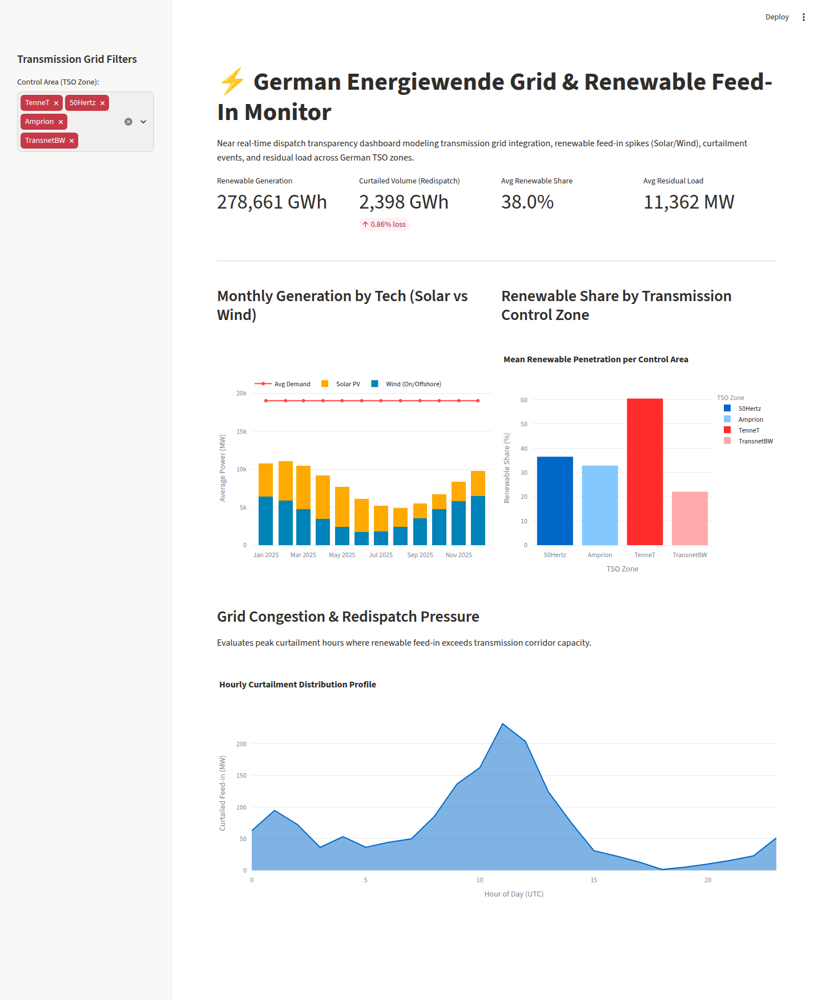

# 🌬️☀️ German Energiewende: Renewable Feed-In & Curtailment Dashboard

[](https://german-renewable-energy.streamlit.app/)  
**Live demo:** https://german-renewable-energy.streamlit.app/

An interactive **Streamlit** dashboard that makes renewable energy integration in the German grid easy to read for non-technical stakeholders: how much wind and solar is produced, how it compares to demand, and when and where feed-in has to be curtailed.

> The data is **synthetic**: one year (2025) of hourly values for the four German TSO control areas (TenneT, 50Hertz, Amprion, TransnetBW), generated with realistic seasonal and daily patterns. It is created automatically on first run.



## 📊 What the Dashboard Shows

| View | Question it answers |
|---|---|
| **KPI cards** | Total renewable generation, curtailed volume (and % lost), average renewable share, average residual load |
| **Monthly generation mix** | How do wind and solar complement each other over the seasons, compared to demand? |
| **Renewable share by TSO zone** | Which control areas run on the highest share of renewables? |
| **Hourly curtailment profile** | At which hours of the day does feed-in exceed grid capacity most often? |

A sidebar filter lets you compare any combination of TSO zones.

## 🧮 How the Data Is Modelled

`src/pipeline.py` builds the hourly time series per TSO zone:

- **Solar**: daily sine curve peaking at midday, stronger in summer, scaled by zone
- **Wind**: beta-distributed output with a winter peak, highest in the northern zones (TenneT, 50Hertz)
- **Demand**: daily load cycle with random variation
- **Curtailment**: triggered when renewable feed-in exceeds 115 % of demand
- **Residual load**: demand minus renewable feed-in actually used

## 📈 Power BI Version

[`Renewable_PowerBI/`](Renewable_PowerBI/) rebuilds the analysis as a Power BI Project (`.pbip`):

- **Data model:** hourly fact table with date and TSO zone dimensions
- **DAX:** 17 measures covering generation, curtailment, growth and zone ranking
- **Report:** Grid Overview, Curtailment, Zones and Growth, Data Quality

Open `Renewable_Energy.pbip` in Power BI Desktop and click **Refresh**. See the
[Power BI guide](Renewable_PowerBI/README.md) for setup, expected figures and verification status.
The committed CSVs in `data/processed/` can be rebuilt with `python -m src.export_powerbi`.

## 🚀 Quickstart

```bash
python -m venv venv
source venv/bin/activate          # Windows: venv\Scripts\activate
pip install -r requirements.txt

streamlit run app.py
```

On the first start the dataset is generated to `data/renewable_energy_timeseries.parquet` (about 35,000 rows).

Or run the dashboard with Docker, then open http://localhost:8501:

```bash
docker build -t renewable-dashboard .
docker run --rm -p 8501:8501 renewable-dashboard
```

## 🧪 Tests

```bash
pip install pytest
python -m pytest tests/
```

GitHub Actions runs the tests on pushes and pull requests to `main`.

## 🛠️ Tech Stack

Python · Pandas · NumPy · Streamlit · Plotly · Parquet (PyArrow) · Power BI (DAX, Power Query) · Docker · pytest

## 📄 License

[MIT](LICENSE)
