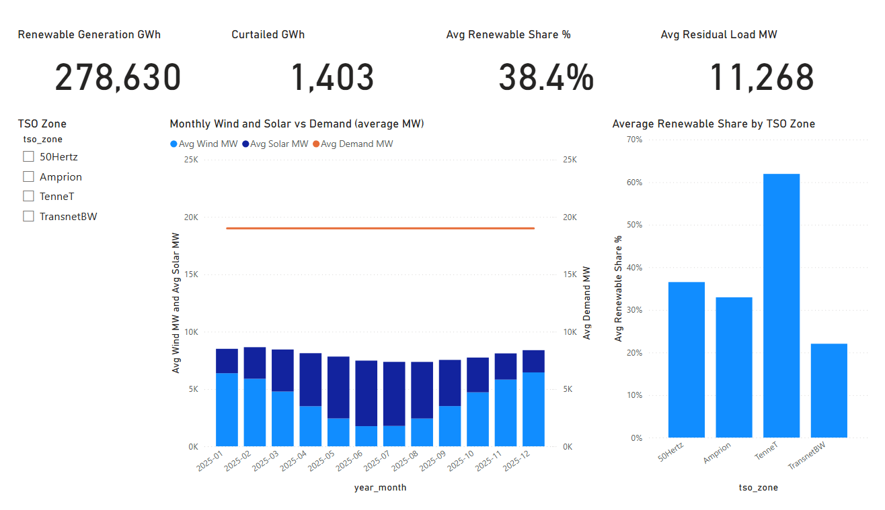
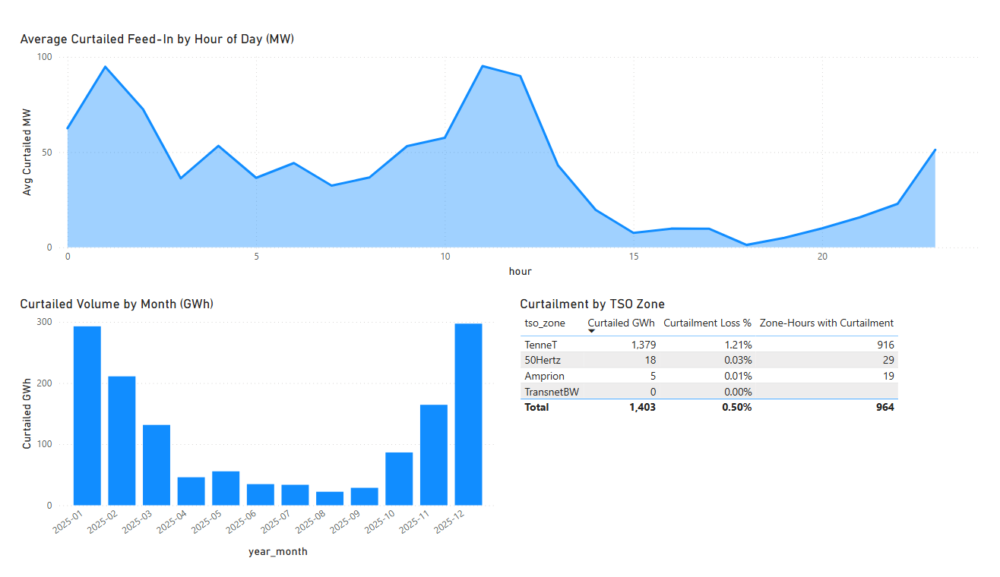
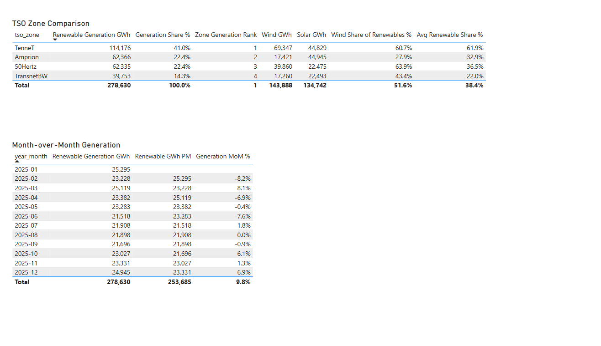
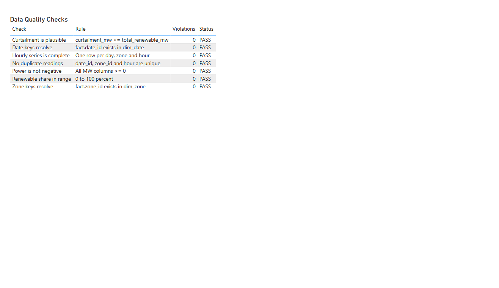

# German Renewable Feed-In: Power BI version

A Power BI rebuild of the Streamlit dashboard in this repo, on a star schema
(`fact_generation` + `dim_date`, `dim_zone`) exported by `python -m src.export_powerbi`.
The data is **synthetic** (hourly values for 2025).

| Layer | What it contains |
|---|---|
| **Power Query (M)** | One reusable `GetCsv` function, a `DataBaseUrl` parameter, typed columns and a `dq_checks` query |
| **Data model** | Two one-to-many relationships and a marked date table (`dim_date[full_date]`) |
| **DAX** | 17 measures: generation and curtailment, average power, month-over-month, zone share and ranking |
| **Report** | Grid Overview, Curtailment, Zones and Growth, Data Quality |

## Open it

1. Use a current version of Power BI Desktop (tested with 2.160, November 2026, with no preview
   settings changed). An older version may need the Power BI Project (.pbip), TMDL and PBIR preview
   features switched on under File, Options and settings, Options, Preview features.
2. Open `Renewable_Energy.pbip`.
3. A PBIP stores no data, so click **Refresh**. When asked how to connect to
   `raw.githubusercontent.com`, choose **Anonymous**. The default address reads the files on the `main` branch.
   If Power BI then asks for **privacy levels**, choose **Public** (the data is public and synthetic)
   and click **Save**.
4. To load local files instead: Home, Transform data, Manage parameters, set `DataBaseUrl`
   to the full path of `data\\processed` in your clone.
5. Save as `.pbix` (File, Save as) if you want a single file to share or publish.

If the project will not open, use `fallback/`: create a blank report, paste each query from
`PowerQuery_queries.m` (create `DataBaseUrl` as a text parameter first), set the relationships and
mark `dim_date` as a date table,
then paste the measures from `DAX_measures.dax`.

## Expected figures (no filters)

Renewable generation **278,630 GWh**, curtailed **1,403 GWh** (loss **0.50%**), average renewable share
**38.4%**, average residual load **11,268 MW**, zone-hours with curtailment **964**.

| TSO zone | Generation GWh | Share of generation | Curtailed GWh | Loss % | Avg renewable share |
|---|---|---|---|---|---|
| TenneT | 114,176 | 41.0% | 1,379 | 1.21% | 61.9% |
| Amprion | 62,366 | 22.4% | 5 | 0.01% | 32.9% |
| 50Hertz | 62,335 | 22.4% | 18 | 0.03% | 36.5% |
| TransnetBW | 39,753 | 14.3% | 0 | 0.00% | 22.0% |

Curtailment peaks at hour **11** (average **95 MW** per zone-hour, with hour 1 almost as high). Month-over-month growth is blank for
January 2025 and **-8.2%** for February. All seven data-quality checks should show PASS.

## Verification

Tested in Power BI Desktop 2.160 on Windows: the project opens, refreshes from GitHub, all 17
measures evaluate without errors, every data-quality check passes, and the figures queried from the loaded
model match an independent calculation in pandas. The screenshots below come from that run.

`tests/test_powerbi.py` checks the files' consistency on every CI run; it does not start Power BI.

## Screenshots

**Grid Overview**

**Curtailment**

**Zones and Growth**

**Data Quality**

